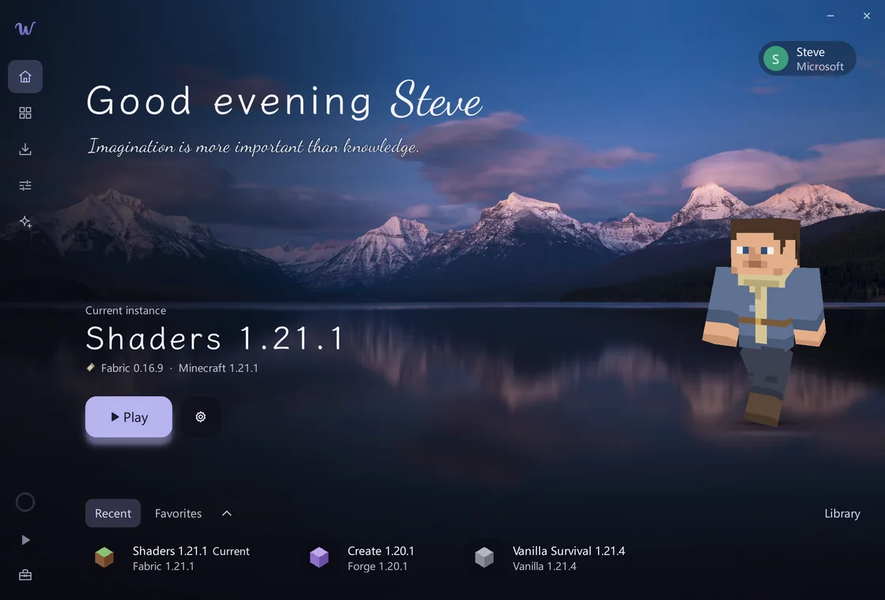
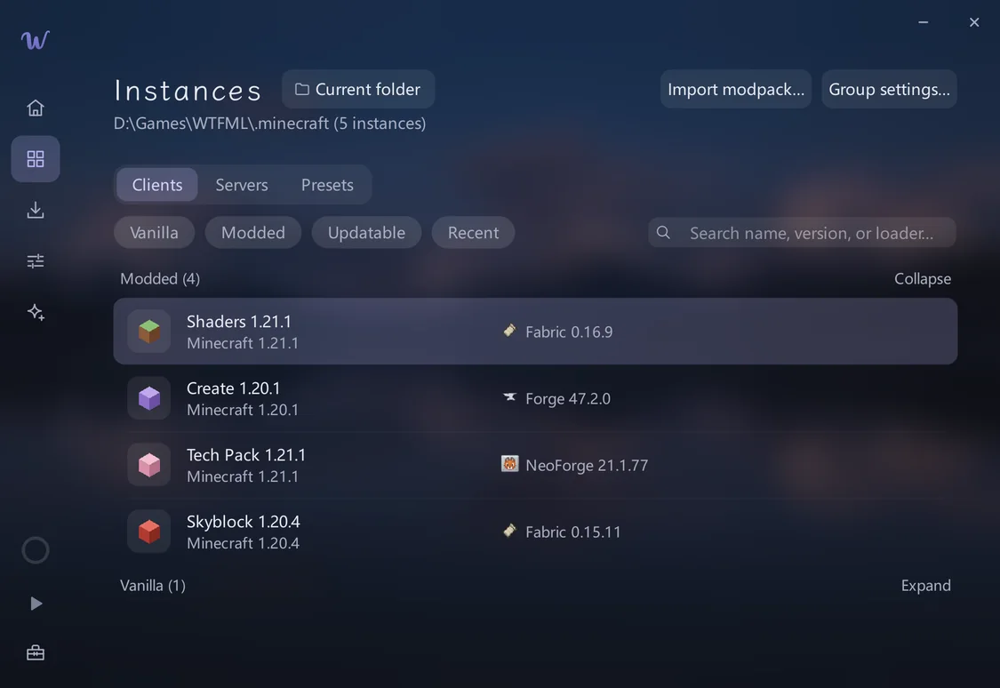
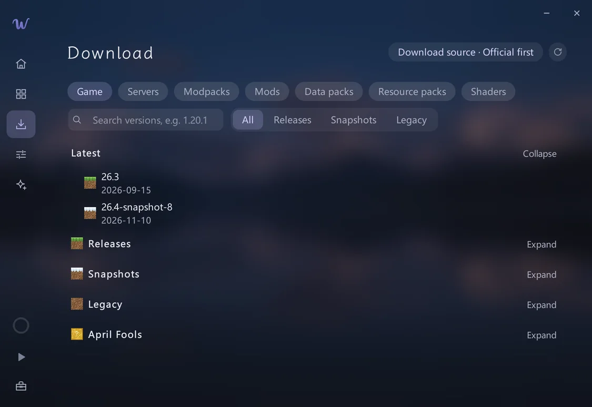
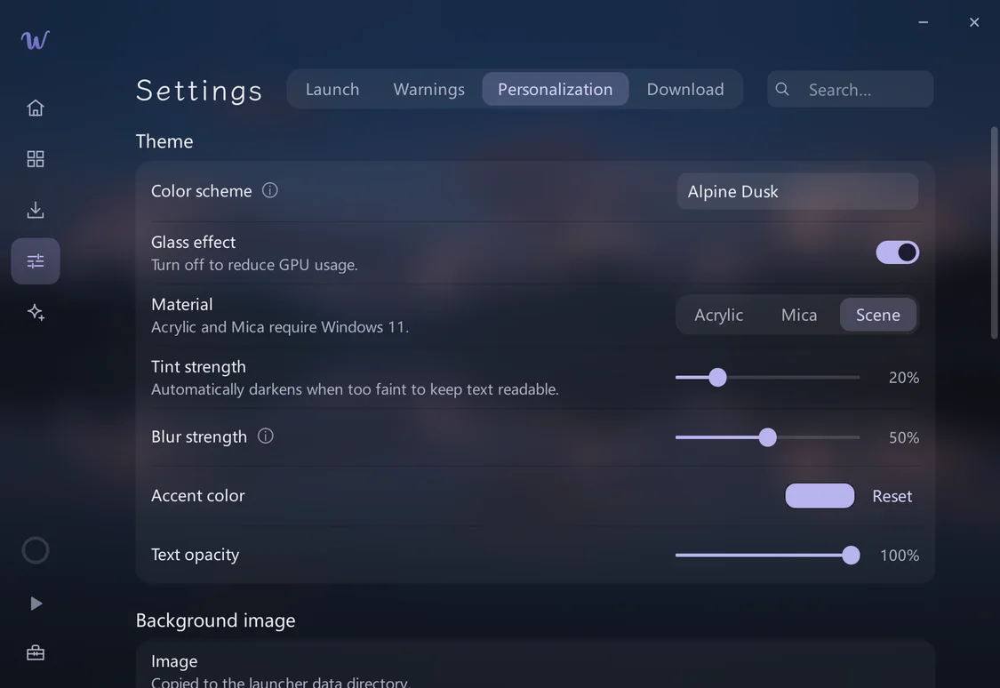
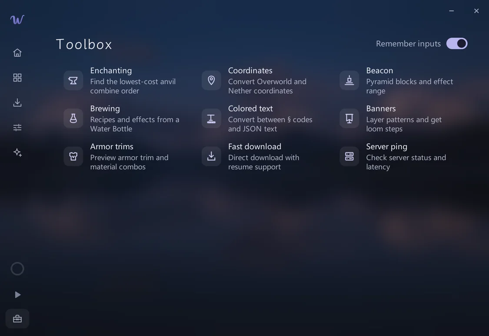
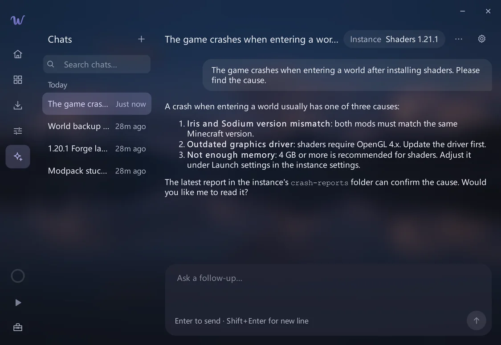
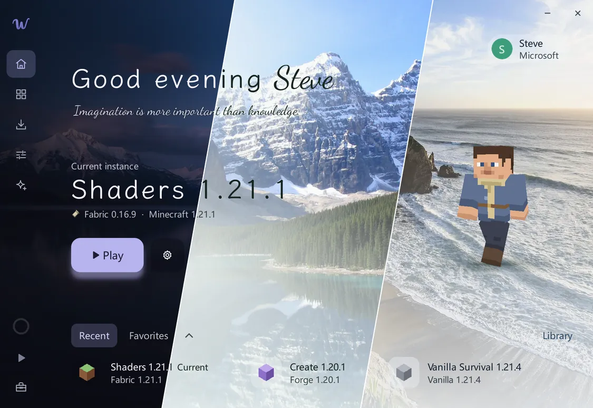

<b>English</b> | <a href="README.zh-CN.md">简体中文</a>

  

An elegant, beautiful, all-in-one, modern Minecraft launcher.

  

A single exe — download and run, nothing to install. Available for Windows x64.

 

## 

  

## 

- **All in one** — Vanilla, Fabric, Quilt, Forge and NeoForge, plus Paper, Purpur and Spigot servers.
- **Accounts** — Microsoft or offline; keep several, switch freely, change skins and capes.
- **Modpacks** — Import ZIP, mrpack, CurseForge or MultiMC / Prism instances; RAR and 7z too with 7-Zip.
- **Instances** — Group and favorite; mods, resource packs, shaders, data packs, worlds and servers in one place.
- **Safe upgrades** — Move to a new game version as a copy, or in place behind a verified full snapshot you can roll back to.
- **Fast downloads** — Concurrent, resumable, speed limit and proxy; existing files verified and reused.
- **Java** — Finds installed Java or fetches one from Adoptium.
- **Servers** — Console, `server.properties` editor, whitelist / ops / bans, backups.
- **Toolbox** — Enchanting order, coordinates, beacons, brewing, banners, colored text, server ping and more.
- **Agent** — Connect an OpenAI-compatible model to read logs and crash reports with you; nothing changes without your approval.
- **Looks** — Three scenic themes over frosted glass; your own background and accent color.

<b>More screenshots</b>

 

<table>
  <tr>
    <td width="50%"> Library — instances and groups</td>
    <td width="50%"> Download — game versions and loaders</td>
  </tr>
  <tr>
    <td width="50%"> Settings — changes save as you go</td>
    <td width="50%"> Toolbox — calculators and helpers for play</td>
  </tr>
  <tr>
    <td width="50%"> Agent — chat about the current instance</td>
    <td width="50%"> Themes — the same home page in all three</td>
  </tr>
</table>

<b>FAQ</b>

 

**Where is my data stored?**

In the game folder you have selected, wherever the exe lives. The launcher's own settings and account list are in the registry under `HKCU\Software\WTFML`; sign-in tokens are encrypted with Windows DPAPI before they touch the disk.

**Where is the log?**

`<game folder>/logs/wtfml.log`, rewritten on every start. The game's own output goes to a separate log window, not this file.

**Can I open two windows?**

One launcher window per game folder at a time; a second one is refused before it opens. A different game folder works fine.

**Where are agent conversations stored?**

`%LOCALAPPDATA%\WTFML\agent`, independent of the game folder. Each conversation can be stored encrypted with DPAPI.

## 

Issues and pull requests are welcome. When reporting a problem, attaching `logs/wtfml.log` saves a lot of back-and-forth. The developer docs are written in Chinese.

- Building, running and source layout: [docs/dev/BUILDING.md](docs/dev/BUILDING.md)
- Running the tests: [docs/dev/TESTING.md](docs/dev/TESTING.md)
- Documentation index: [docs/README.md](docs/README.md)
- Repository rules (layout, docs, commits): [AGENTS.md](AGENTS.md)

## 

WTFML is released under the [GNU GPL v3](LICENSE). Dancing Script and LXGW WenKai, used in the interface, are under the SIL Open Font License. The theme landscapes come from Wikimedia Commons; authors and licenses are listed in [assets/scenes/README.md](assets/scenes/README.md).
