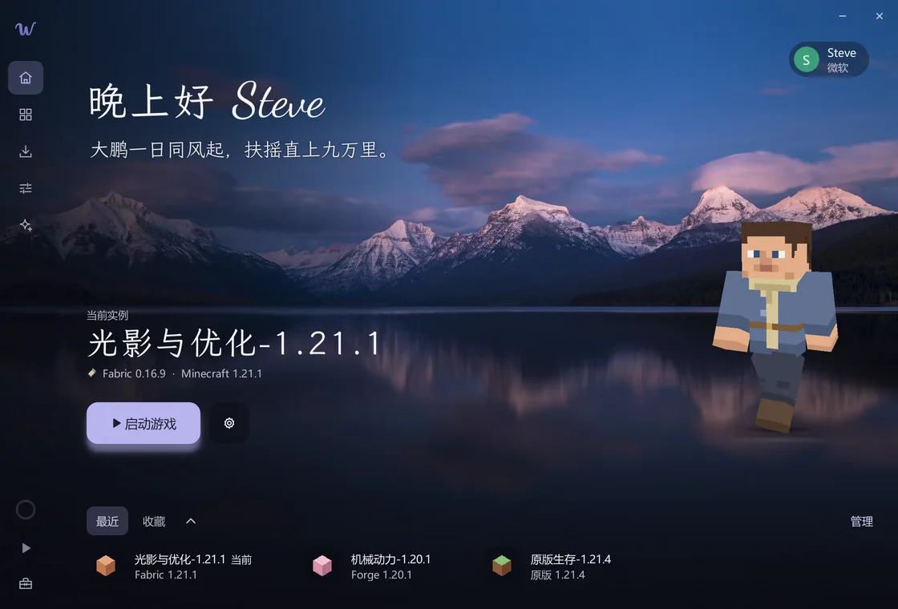
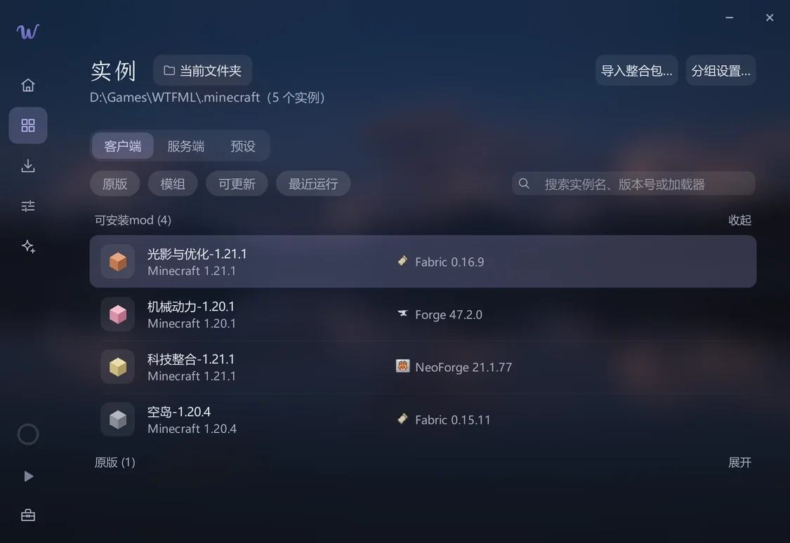
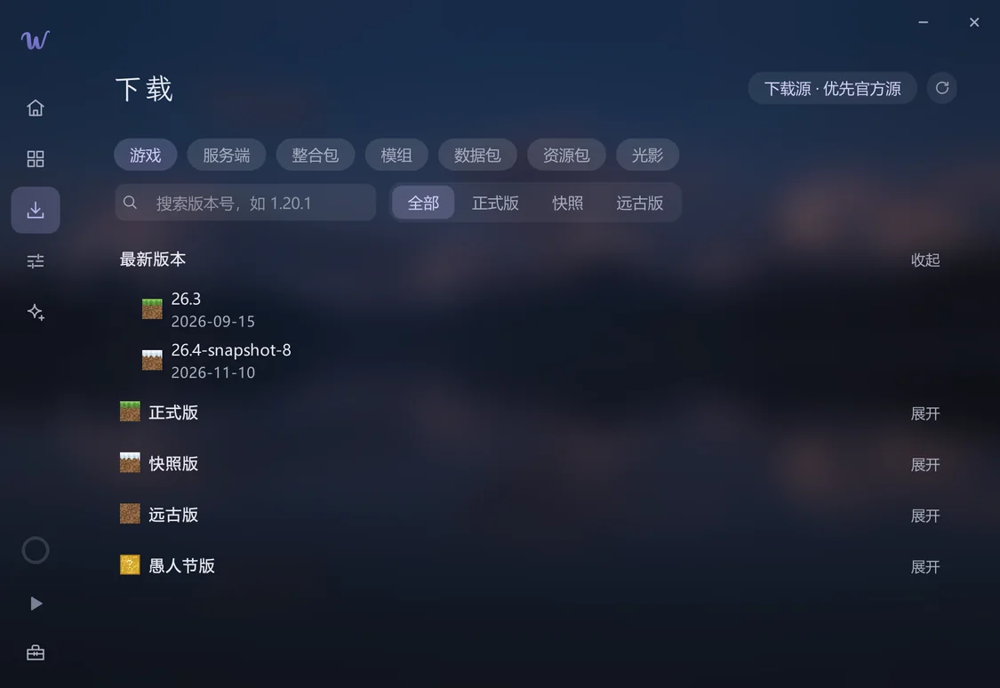
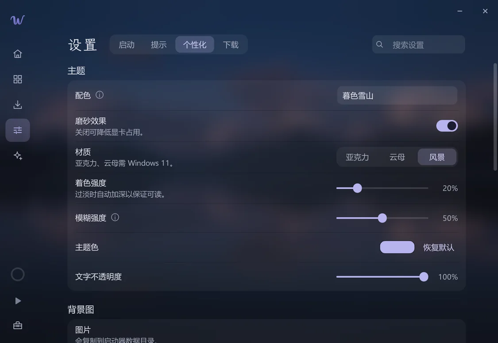
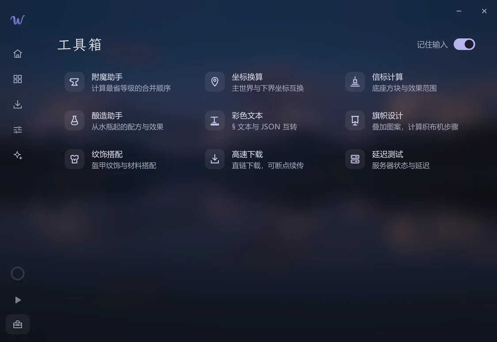
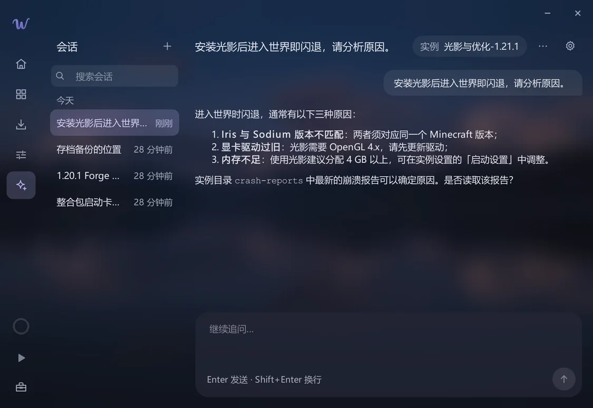
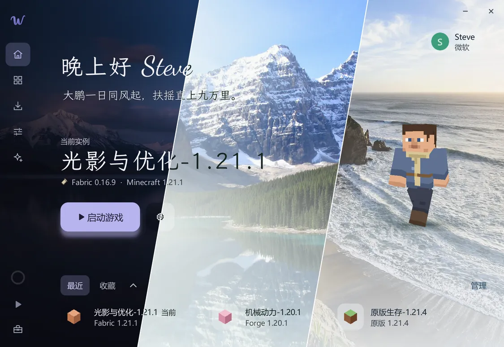

<a href="README.md">English</a> | <b>简体中文</b>

  

优雅、美观、一站式的现代 Minecraft 启动器。

  

单文件 exe，下载即用，不用安装。支持 Windows x64。

 

## 

  

## 

- **一站式**：原版、Fabric、Quilt、Forge、NeoForge 客户端，另有 Paper、Purpur、Spigot 服务端。
- **账号**：微软账号或离线账号，能存好几个随时切换，皮肤和披风也在这里换。
- **整合包**：导入 ZIP、mrpack、CurseForge 导出包和 MultiMC / Prism 实例；装了 7-Zip 还能导入 RAR、7z。
- **实例**：分组、收藏；模组、资源包、光影、数据包、存档、服务器列表都在一处管。
- **放心升级**：换新游戏版本时可以另存一份副本，也可以原地升级；原地升级前先做完整快照并校验，出了问题能回滚。
- **下载**：并发、断点续传、限速、代理；已有的文件先校验，能用就不再下。
- **Java**：找出本机装好的 Java，缺了就从 Adoptium 下一个。
- **服务端**：控制台、`server.properties` 编辑、白名单 / OP / 封禁、备份。
- **工具箱**：附魔顺序、坐标换算、信标、酿造、旗帜、彩色文本、服务器延迟等。
- **智能体**：接入兼容 OpenAI 接口的模型，陪你一起看日志和崩溃报告；不经你同意，什么都不改。
- **外观**：三套风景主题配磨砂玻璃，背景图和主题色都能换成自己的。

<b>更多截图</b>

 

<table>
  <tr>
    <td width="50%"> 管理：实例列表与分组</td>
    <td width="50%"> 下载：游戏版本与加载器</td>
  </tr>
  <tr>
    <td width="50%"> 设置：更改即时保存</td>
    <td width="50%"> 工具箱：常用计算与查询工具</td>
  </tr>
  <tr>
    <td width="50%"> 智能体：围绕当前实例对话</td>
    <td width="50%"> 主题：暮色雪山、冰川碧湖、落日海崖</td>
  </tr>
</table>

<b>常见问题</b>

 

**数据放在哪里**

在当前选中的游戏文件夹里，和 exe 放在哪无关。启动器自己的设置和账号表在注册表 `HKCU\Software\WTFML`，登录令牌经 Windows DPAPI 加密后才落盘。

**日志在哪里**

`<游戏文件夹>/logs/wtfml.log`，每次启动重写一份。游戏自己的输出在单独的日志窗口里，不进这份文件。

**能同时开两个窗口吗**

同一个游戏文件夹同时只能开一个启动器窗口，第二个在打开前就会被拒绝；换一个游戏文件夹就可以。

**智能体的对话存在哪里**

`%LOCALAPPDATA%\WTFML\agent`，不跟着游戏文件夹走。每个会话可以单独选择用 DPAPI 加密存储。

## 

欢迎提 issue 和 PR。遇到问题时附上 `logs/wtfml.log`，能省很多来回。

- 构建、运行与目录结构：[docs/dev/BUILDING.md](docs/dev/BUILDING.md)
- 测试怎么跑：[docs/dev/TESTING.md](docs/dev/TESTING.md)
- 文档索引：[docs/README.md](docs/README.md)
- 仓库规则（目录布局、文档、提交）：[AGENTS.md](AGENTS.md)

## 

WTFML 以 [GNU GPL v3](LICENSE) 发布。界面里的 Dancing Script 与霞鹜文楷遵循 SIL Open Font License；三套主题的风景照来自 Wikimedia Commons，作者与许可见 [assets/scenes/README.md](assets/scenes/README.md)。
